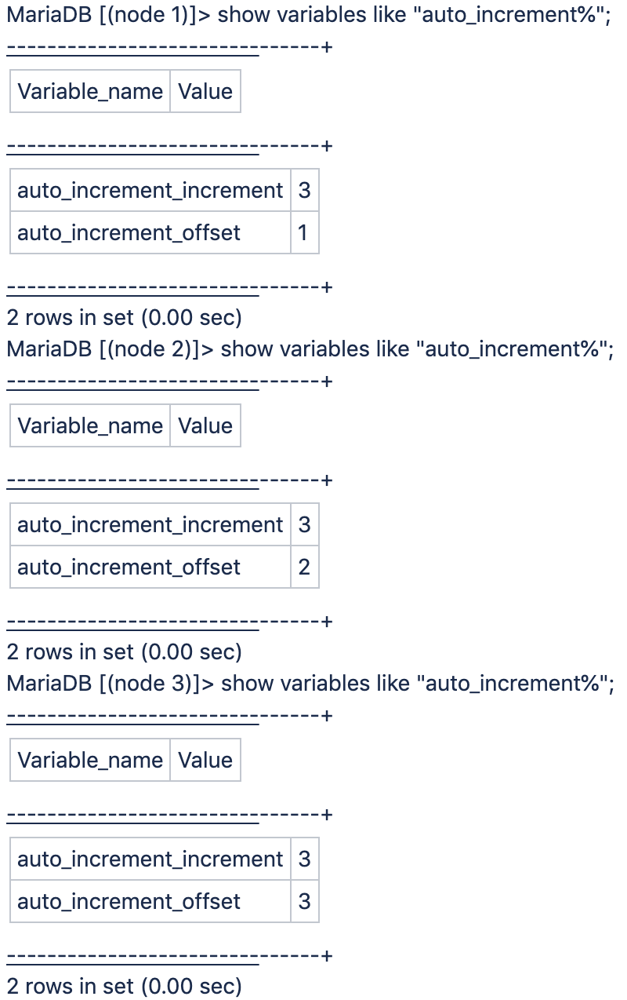

# Cloud Pro アーキテクチャで、Database auto_increment incrementの増分変数を「3」のAdobe Commerceに設定

これは、3 ノードアーキテクチャが原因でAdobe Commerce on cloud infrastructure Pro プランアーキテクチャソリューションで期待される動作であり、変更できません。

Galera データベースクラスターが使用されます。これは、ノードごとに1つのMariaDB MySQL データベースを持つデータベースクラスターで、各データベース全体の一意のIDに対して3つの自動増分設定を持ちます。

<u>Pro クラスターで使用される増分IDが、必ずしも3で分離または増分されないのはなぜですか？</u>

Galeraの仕組みにより、クラスターで使用される増分IDが常に3で分離/増分されるわけではありません。

3つのサーバーはそれぞれ独自のID スペースを管理し、使用される増分は、どのMySQL メインデータベースサーバー（相対負荷に応じて）であるかによって異なるため、ギャップが異なります。
各ノードにSSH接続し、そのノードで実行されているローカル MySQL インスタンスにポート 3307を使用して接続する場合（標準ポート 3306の「main」にプロキシするのではなく）、次の図が表示されます。

例えば、選択されたメインが`auto_increment_offset = 1`のノード 1である場合、IDは1増加します。 次に、後で新しいメインノードが選択された場合（例：`auto_increment_offset = 3`のノード 3）は、代わりに3ずつ増加します。

## 便利なリンク

アドビの開発者向けドキュメントをご覧ください。

* [Cloud for Adobe Commerce > Pro アーキテクチャ > バックアップと災害復旧](https://experienceleague.adobe.com/ja/docs/commerce-cloud-service/user-guide/architecture/pro-architecture#backup-and-disaster-recovery)
* [Cloud for Adobe Commerce/前提条件のインストール：database](https://experienceleague.adobe.com/ja/docs/commerce-cloud-service/user-guide/develop/overview)
