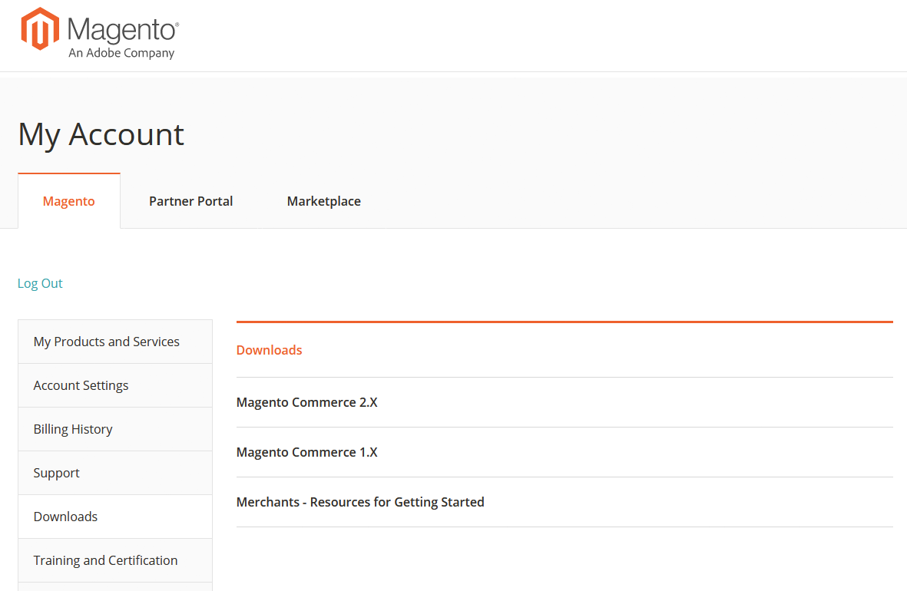

# Adobe Commerce カスタマーサポートガイドにアクセス

Adobe Commerce カスタマーサポートガイドでは、カスタマーサポートの内容とその活用方法について説明しています。 これには、サポート関係のベストプラクティス、診断に必要な情報の収集、カスタマーサポートの優先順位、サポートリクエストの提出、リソースへのリンクが含まれます。 このガイドには、Magento アカウントページの「ダウンロード」セクションからアクセスできます。 アクセス方法：

1. Magento [&#x200B; アカウントのログインページに移動します。](https://account.magento.com/customer/account/login)
1. Magentoのユーザー名とパスワードでログインします。
1. 左側のナビゲーションバーで、「**ダウンロード**」をクリックします。
1. 右側のウィンドウで、**Merchants - Resources for Getting Started**&#x200B;をクリックします。  
