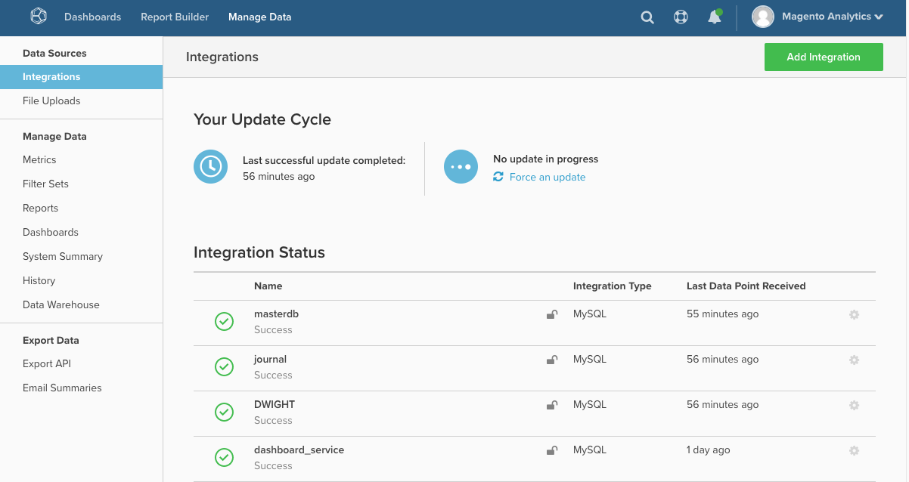

# MBI：統合の再認証

この記事では、Magento Business Intelligence （MBI）にサードパーティサービスからデータを取得するために必要な権限を付与するために、統合を再認証するためのソリューションを提供します。 これらの権限が失効した場合は、再認証が必要です。

## データベースとSaaSの統合

データベースとSaaS統合のリストについては、開発者ドキュメントの「[統合を使用した外部データの接続](https://experienceleague.adobe.com/en/docs/commerce-business-intelligence/mbi/analyze/saas/integrations)」を参照してください。 （ページを開く場合は、左側の目次を使用してナビゲーションを行います）。

## 接続に問題がありますか？

統合を許可すると、MBIはサードパーティサービスからデータを取得するために必要な権限を付与されます。 これらの権限が失効した場合は、再認証が必要です。

これは、次のような理由により発生する可能性があります。

* サードパーティサービスの問題
* 認証トークンの有効期限
* 管理アカウントで行われた変更
* 内部的な問題があれば

すべての統合のステータスは、統合ページ（**データの管理/統合**）にあります。

再認証するには、アカウントの資格情報を再入力する必要がある場合があります。 場合によっては、問題の統合用に新しいAPI キーを生成する必要が生じる場合があります。 問題の統合名をクリックして、再認証プロセスを開始します。

問題が解決しない場合は、[&#x200B; サポートチケットを送信してください](https://experienceleague.adobe.com/en/docs/support-resources/adobe-support-tools-guide/adobe-commerce-support/adobe-commerce-help-center-user-guide#submit-ticket)。
