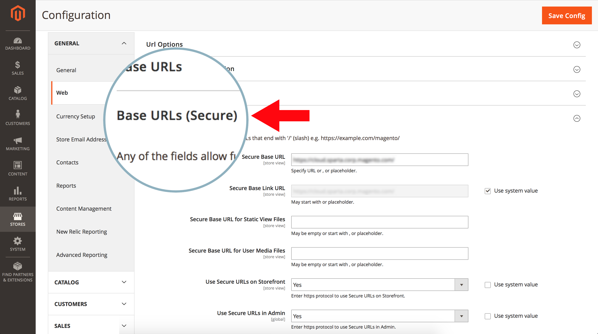
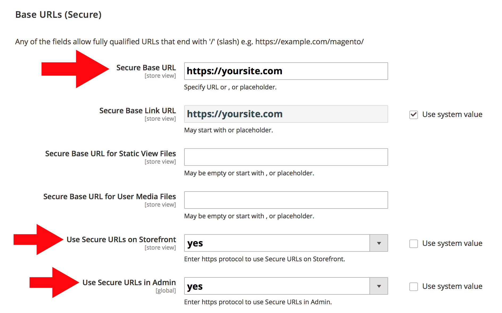
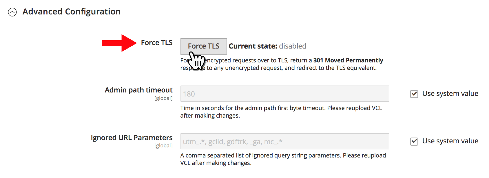
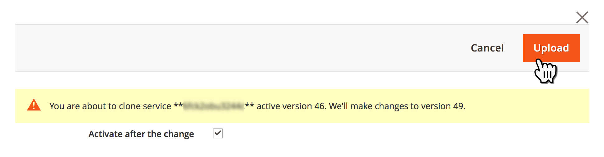
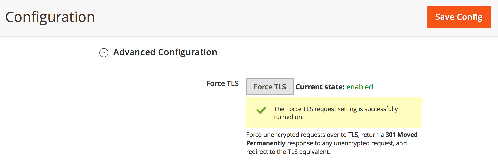

# Adobe Commerce クラウドインフラストラクチャ上のすべてのページのHTTPをHTTPSにリダイレクト（TLSを強制）

Commerce管理者でFastlyの&#x200B;**Force TLS**&#x200B;機能を有効にして、Adobe Commerce on cloud infrastructure ストアのすべてのページでグローバル HTTPからHTTPSへのリダイレクトを有効にします。

この記事では、[手順](#steps)の詳細、TLSの強制機能の概要、影響を受けるバージョン、関連ドキュメントへのリンクについて説明します。

## 手順 {#steps}

### 手順1：セキュア URLの設定 {#step-1-configure-secure-urls}

このステップでは、ストアの安全なURLを定義します。 既に完了している場合は、[手順2: TLSを強制的に有効にする](#step-2-enable-force-tls)に移動します。

1. Commerce Adminにログインします。
1. **Stores** > **Configuration** > **General** > **Web**&#x200B;に移動します。
1. 「**ベース URL （セキュア）**」セクションを展開します。   
1. 「**セキュアベース URL**」フィールドに、ストアのHTTPS URLを指定します。
1. 「**ストアフロントでセキュア URLを使用**」と「**管理者**&#x200B;設定でセキュア URLを使用」を「**はい**」に設定します。
1. 右上隅の&#x200B;**設定を保存**&#x200B;をクリックして、変更を適用します。

**ユーザーガイドの関連ドキュメント：** [URLの保存](https://experienceleague.adobe.com/en/docs/commerce-admin/stores-sales/site-store/store-urls)。

### 手順2: TLSの強制を有効にする {#step-2-enable-force-tls}

1. Commerce管理者で、**Stores** > **Configuration** > **Advanced** > **System**&#x200B;に移動します。
1. 「**フルページキャッシュ**」セクションを展開し、**Fastly設定**、**詳細設定**」を展開します。
1. 「**TLS**&#x200B;を強制」ボタンをクリックします。   
1. 表示されるダイアログで、**アップロード**&#x200B;をクリックします。
1. ダイアログが閉じた後、現在のForce TLSの状態が&#x200B;**enabled**&#x200B;と表示されていることを確認します。

**関連するFastly ドキュメント：** [Adobe Commerce 2のTLS ガイド ](https://github.com/fastly/fastly-magento2/blob/master/Documentation/Guides/FORCE-TLS.md)を強制します。

## Force TLSについて

TLS （Transport Layer Security）は、セキュリティの低い先行プロトコルであるSSL （Secure Socket Layer）プロトコルに代わる、セキュアなHTTP接続のためのプロトコルです。

FastlyのForce TLS機能を使用すると、サイトページに対するすべての暗号化されていないリクエストをTLSに強制できます。

>>
これは、暗号化されていないリクエストに対して&#x200B;*301 Moved Permanently*&#x200B;応答を返し、TLS同等のリクエストにリダイレクトすることで機能します。 例えば、*http://www.example.com/foo.jpeg*&#x200B;のリクエストを行うと、*https://www.example.com/foo.jpeg*&#x200B;にリダイレクトされます。

[通信の保護](https://docs.fastly.com/guides/securing-communications/) （Fastly ドキュメント）

## 影響のあるバージョン

* **クラウド インフラストラクチャ上のAdobe Commerce:**
  * バージョン：2.1.4以降
  * プラン：Adobe Commerce on cloud infrastructure スタータープランアーキテクチャおよびAdobe Commerce on cloud infrastructure Pro プランアーキテクチャ（Pro Legacyを含む）
* **Fastly:** 1.2.4

## routes.yamlに変更は必要ありません

ストアの&#x200B;**すべての** ページでHTTPからHTTPS リダイレクトを有効にするには、ページを`routes.yaml`設定ファイルに追加する必要はありません。ストア全体でTLSを強制的に有効にする（Commerce管理者を使用）だけで十分です。

## 関連するFastly ドキュメント

* [Adobe Commerce 2のTLS ガイドを強制](https://github.com/fastly/fastly-magento2/blob/master/Documentation/Guides/FORCE-TLS.md)
* [TLS リダイレクトの強制](https://docs.fastly.com/guides/securing-communications/forcing-a-tls-redirect)
* [通信の保護](https://docs.fastly.com/guides/securing-communications/)
