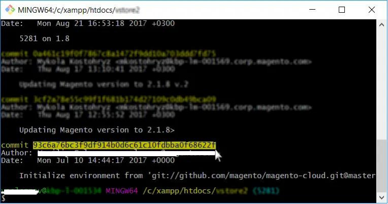

# Adobe Commerce クラウドインフラストラクチャ上の環境をリセットする

この記事では、Adobe Commerce on cloud infrastructureで環境をロールバックする様々なシナリオについて説明します。

>[!NOTE]
>
>このガイドは、すべてのCloud Starter環境およびCloud Proの統合環境にのみ適用されます。

ケースに最適なものを選択します。

* アクティビティを計画している場合（デプロイメントまたはアップグレードを計画） - [&#x200B; シナリオ 1：計画アクティビティ） &#x200B;](#scen1)。
* 有効なスナップショットがある場合 – [&#x200B; シナリオ 2: スナップショットを復元](#scen2)。
* 安定したビルドを持っているが、有効なスナップショットがない場合 – [&#x200B; シナリオ 3: スナップショットがない場合、安定したビルド （SSH接続が利用可能） &#x200B;](#scen3)。
* ビルドが壊れており、有効なスナップショットがない場合 – [&#x200B; シナリオ 4: スナップショットがありません。ビルドが壊れています（SSH接続なし） &#x200B;](#scen4)。

## シナリオ 1：計画されたアクティビティ

計画されたデプロイメントまたはアップグレードでは、最も簡単かつ推奨される[!UICONTROL Rollback]は、準備の一環として、マーチャントが次の操作を行うことです。

>[!NOTE]
>
>最初に下位環境でこれらの手順を常にテストしてください。

<u> アップグレード/デプロイメント アクティビティの5日前</u>:

1. 現在のデータベースのサイズを確認します。
1. [!UICONTROL Database Dump]を保持するのに十分なディスク領域が`/data/exports`にあることを確認してください。 十分なディスク容量がない場合は、不要なデータを削除するか、サポートケースを作成してディスクの拡張をリクエストします。

<u>変更日</u>:

1. Web サイトを[!UICONTROL Maintenance Mode]に配置します。
[&#x200B; ユーザーガイドの[!UICONTROL Maintenance Mode]](https://experienceleague.adobe.com/docs/commerce-operations/installation-guide/tutorials/maintenance-mode.html?lang=ja)を有効または無効にする方法と、アップグレード ガイドの[&#128279;](https://experienceleague.adobe.com/docs/commerce-operations/upgrade-guide/troubleshooting/maintenance-mode-options.html?lang=ja)のアップグレード用オプション [!UICONTROL Maintenance Mode]について詳しくお読みください。
1. cron ジョブを無効にします。 cron ジョブの無効化について詳しくは、[crons プロパティガイド &#x200B;](https://experienceleague.adobe.com/ja/docs/commerce-cloud-service/user-guide/configure/app/properties/crons-property#disable-cron-jobs)を参照してください。
1. ローカル [[!UICONTROL Database Dump]](https://experienceleague.adobe.com/docs/commerce-knowledge-base/kb/how-to/create-database-dump-on-cloud.html?lang=ja)を使用します。

<u>[!UICONTROL Rollback]が必要な場合</u>:

1. [!DNL MariaDB]などのアプリケーションがこの計画的なアクティビティの一部としてアップグレードされた場合は、そのアプリケーションを最初に以前のバージョンに再インストールしてください。
1. ローカル [!UICONTROL Database Dump]を使用してデータベース [!UICONTROL Rollback]を作成し、これを[!DNL MariaDB]に読み込みます。
1. [!DNL Git]経由のコードを以前のバージョンに[!UICONTROL Rollback]します。

[!UICONTROL Snapshots]の使用は、ローカル [!UICONTROL Database Dump]と比較してデータを取得するのに長い時間がかかるため、**のステップ 2で前述したように、[!UICONTROL Rollback]が必要な場合** セクションで説明したように、アップグレード/計画アクティビティ [!UICONTROL rollbacks/restores]では推奨される方法ではありません。

[!UICONTROL Snapshots]はノード/サーバー上で保持されず、別のストレージブロックに保持されます。そのデータはブロックストレージからネットワーク経由で新しいディスクに送信する必要があるため、プロセスに時間がかかります。 その後、その新しいディスクは、ノード/サーバーに接続された元のディスクに読み込み/読み込み可能なノードにマウントされます。

これをローカル [!UICONTROL Database Dump]の読み込みと比較すると、データは既にノード/サーバーで取得可能であるため、[!UICONTROL Database Import]のみが必要なため、多くの時間が保存されます。

## シナリオ 2: スナップショットを復元する

クラウドインフラストラクチャ上のAdobe Commerce上のスナップショットの復元[&#128279;](https://experienceleague.adobe.com/ja/docs/commerce-cloud-service/user-guide/develop/storage/snapshots#restore-snapshot)については、開発者向けドキュメントをご覧ください。

>[!NOTE]
>
>Adobe Commerce on cloud infrastructure アカウントにアクセスしてから、大きな変更を適用する前に、スナップショットを作成することが最初の手順である必要があります。 これはベストプラクティスであり、強くお勧めします。

詳しくは、開発者ドキュメントの[&#x200B; スナップショットの作成](https://experienceleague.adobe.com/ja/docs/commerce-cloud-service/user-guide/develop/storage/snapshots#create-snapshot)を参照してください。

## シナリオ 3: スナップショットなし、ビルドの安定した状態（SSH接続が利用可能）

このセクションでは、スナップショットを作成していないが、SSH経由で環境にアクセスできる場合の環境のリセット方法について説明します。

手順は次のとおりです。

1. 構成管理を無効にします。
1. Adobe Commerce ソフトウェアをアンインストールします。
1. [!DNL git] ブランチをリセットします。

次の手順を実行した後：

* Adobe CommerceのインストールがVanilla状態に戻ります（データベースが復元されました。デプロイメント設定は削除されました。`var`以下のディレクトリはクリアされました）。
* [!DNL git] ブランチが過去の状態にリセットされました。

詳細な手順は、次のとおりです。

### 手順0 （前提条件）:config.phpを削除してConfiguration Managementを無効にする

デプロイメント時に以前の設定設定を自動的に適用しないように、構成管理を無効にする必要があります。

構成管理を無効にするには、`/app/etc/` ディレクトリに`config.php` ファイルが含まれていないことを確認してください。

設定ファイルを削除するには、次の手順に従います。

1. [環境へのSSH](https://experienceleague.adobe.com/docs/commerce-cloud-service/user-guide/develop/secure-connections.html?lang=ja)。
1. 設定ファイルを削除します：`rm app/etc/config.php`

ストア設定の[構成管理](https://experienceleague.adobe.com/docs/commerce-cloud-service/user-guide/configure-store/store-settings.html?lang=ja)の詳細については、開発者ドキュメントをご覧ください。

### 手順1: setup:uninstall コマンドを使用してAdobe Commerce ソフトウェアをアンインストールする


Adobe Commerce ソフトウェアをアンインストールすると、データベースが削除および復元され、デプロイメント設定が削除され、`var`の下のディレクトリがクリアされます。

開発者向けドキュメントの[Adobe Commerce ソフトウェアのアンインストール &#x200B;](https://experienceleague.adobe.com/docs/commerce-operations/installation-guide/tutorials/uninstall.html?lang=ja)をお読みください。

Adobe Commerce ソフトウェアをアンインストールするには、次の手順に従います。

1. [環境へのSSH](https://experienceleague.adobe.com/docs/commerce-cloud-service/user-guide/develop/secure-connections.html?lang=ja)。
1. `setup:uninstall`を実行：`bin/magento setup:uninstall`
1. アンインストールを確認します。

アンインストールが正常に完了したことを確認するには、次のメッセージが表示されます。

```php
[SUCCESS]: Magento uninstallation complete.
```

つまり、Adobe Commerceのインストール（DBを含む）を真正の（Vanilla）状態に戻しました。

### 手順2: [!DNL git] ブランチをリセットする

[!DNL git]がリセットされると、コードを過去の状態に戻します。

1. ローカル開発環境への環境の複製。 Cloud Consoleでコマンドをコピーできます：
1. コミット履歴へのアクセス： `--reverse`を使用して履歴を逆順で表示すると、より便利になります：`git log --reverse`
1. コミット ハッシュを選択します。 コードを実際の状態（Vanilla）にリセットするには、ブランチ（環境）を作成した最初のコミットを見つけます。
   
1. ハード [!DNL git]のリセットを適用：`git reset --h <commit_hash>`
1. サーバーに変更をプッシュします：`git push --force <origin> <branch>`

これらの手順を実行すると、[!DNL git] ブランチがリセットされ、[!DNL git]の変更ログ全体がクリアされます。 最後の[!DNL git]回のプッシュトリガーにより、すべての変更を適用してAdobe Commerceを再インストールするデプロイが行われました。

## シナリオ 4: スナップショットがありません。ビルドが壊れています（[!DNL SSH]接続がありません）

この節では、環境が重大な状態にある場合に環境をリセットする方法を説明します。デプロイメント手順では、動作するアプリケーションの構築に成功できず、[!DNL SSH]接続を使用できなくなります。

この場合は、まず[!DNL git] resetを使用してAdobe Commerce アプリケーションの動作状態を復元してから、Adobe Commerce ソフトウェアをアンインストールする必要があります（データベースをドロップして復元するには、デプロイメント設定を削除するなど）。 シナリオには、シナリオ 3と同じステップが含まれますが、ステップの順序は異なり、追加のステップ（強制的な再展開）があります。 手順は次のとおりです。

1. [&#x200B; [!DNL git] 分岐をリセットします。](/help/how-to/general/reset-environment-on-cloud.md#reset-git-branch)
1. [構成管理を無効にします。](/help/how-to/general/reset-environment-on-cloud.md#disable_config_management)
1. [Adobe Commerce ソフトウェアをアンインストールします。](/help/how-to/general/reset-environment-on-cloud.md#setup-uninstall)
1. 強制的に再展開する。

これらの手順を実行すると、シナリオ 3と同じ結果が得られます。

### 手順4：強制的に再デプロイ

コミットを行い（これは空のコミットかもしれませんが、推奨しません）、トリガーの再デプロイのためにサーバにプッシュします。

```git
git commit --allow-empty -m "<message>" && git push <origin> <branch>
```

## セットアップ :uninstallが失敗した場合は、データベースを手動でリセットしてください

`setup:uninstall` コマンドの実行がエラーで失敗し、完了できない場合は、次の手順でDBを手動でクリアできます。

1. [環境へのSSH](https://experienceleague.adobe.com/docs/commerce-cloud-service/user-guide/develop/secure-connections.html?lang=ja)。
1. MySQL DBに接続します：`mysql -h database.internal` （Pro環境の場合は、[MySQL サービスの設定](https://experienceleague.adobe.com/docs/commerce-cloud-service/user-guide/configure/service/mysql.html?lang=ja)を参照）。
1. `main` DBをドロップ : `drop database main;`
1. 空の`main` DBを作成：`create database main;`
1. 次の設定ファイルを削除します：`config.php`、`config.php.bak`、`env.php`、`env.php.bak`

DBをリセットした後、[a [!DNL git]  プッシュしてトリガーの再デプロイ &#x200B;](https://experienceleague.adobe.com/docs/commerce-operations/configuration-guide/deployment/examples/example-using-cli.html?lang=ja)を行い、新しく作成したDBにAdobe Commerceをインストールします。 または[redeploy コマンドを実行します](https://experienceleague.adobe.com/docs/commerce-cloud-service/user-guide/dev-tools/cloud-cli.html?lang=ja#environment-commands)。
