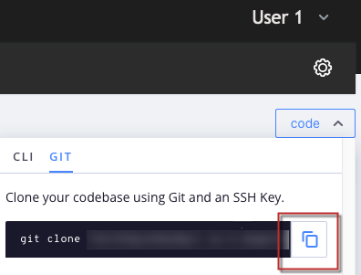
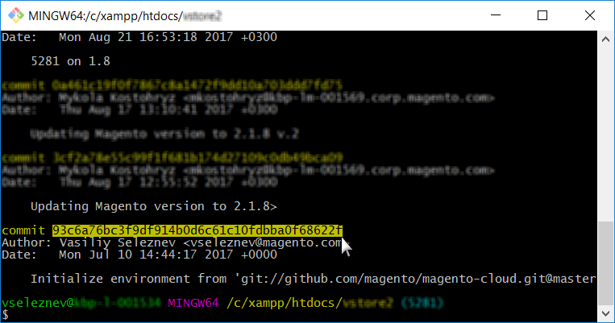

# Cloud スナップショットを使用せずに環境をロールバックする

この記事では、Adobe Commerce on cloud infrastructure上の環境のスナップショットを持たずに環境をロールバックするための2つのソリューションについて説明します。

## 影響を受ける製品とバージョン

* クラウドインフラストラクチャ上のAdobe Commerce、[&#x200B; サポートされているすべてのバージョン &#x200B;](https://magento.com/sites/default/files/magento-software-lifecycle-policy.pdf)

ケースに最適なものを選択します。

* 安定したビルドを持っているが、有効なスナップショットがない場合 – [&#x200B; シナリオ 1: スナップショットがない場合、安定したビルド （SSH接続が利用可能） &#x200B;](#scen2)。
* ビルドが壊れており、有効なスナップショットがない場合 – [&#x200B; シナリオ 2: スナップショットがありません。ビルドが壊れています（SSH接続なし） &#x200B;](#scen3)。

## シナリオ 1: スナップショットなし、ビルドの安定した状態（SSH接続が利用可能） {#scen2}

この節では、スナップショットを作成していないが、SSH経由で環境にアクセスできる場合に、環境をロールバックする方法を説明します。

手順は次のとおりです。

1. 構成管理を無効にします。
1. Adobe Commerce ソフトウェアをアンインストールします。
1. Git ブランチをリセットします。

次の手順を実行した後：

* Adobe Commerce インストールがVanilla状態に戻ります（データベースが復元されました。デプロイメント設定が削除されました。`var`以下のディレクトリがクリアされました）
* git ブランチが過去の状態にリセットされます

詳細な手順は、次のとおりです。

### 手順0 （前提条件）:config.phpを削除してConfiguration Managementを無効にする {#disable_config_management}

デプロイメント時に以前の設定設定を自動的に適用しないように、構成管理を無効にする必要があります。

Configuration Managementを無効にするには、`/app/etc/` ディレクトリに`config.php` （Adobe Commerce 2.4.xの場合）または`config.local.php` （Adobe Commerce 2.1.xの場合）ファイルが含まれていないことを確認します。

設定ファイルを削除するには、次の手順に従います。

1. [環境へのSSH](https://experienceleague.adobe.com/docs/commerce-cloud-service/user-guide/develop/secure-connections.html?lang=ja)。
1. 設定ファイルを削除します。
   * Adobe Commerce 2.4の場合

   ```php
    rm app/etc/config.php
   ```

   * Adobe Commerce 2.1の場合

   ```php
     rm app/etc/config.local.php
   ```

ストア設定の[構成管理](https://experienceleague.adobe.com/docs/commerce-cloud-service/user-guide/configure-store/store-settings.html?lang=ja)を確認して、構成管理について詳しくは、開発者ドキュメントを参照してください。

### 手順1: setup:uninstall コマンドを使用してAdobe Commerce ソフトウェアをアンインストールする {#setup-uninstall}


Adobe Commerce ソフトウェアをアンインストールすると、データベースが削除および復元され、デプロイメント設定が削除され、`var`の下のディレクトリがクリアされます。

開発者向けドキュメントの[Adobe Commerce ソフトウェアのアンインストール &#x200B;](https://experienceleague.adobe.com/docs/commerce-operations/installation-guide/tutorials/uninstall.html?lang=ja)を確認してください。

Adobe Commerce ソフトウェアをアンインストールするには、次の手順に従います。

1. [環境へのSSH](https://experienceleague.adobe.com/docs/commerce-cloud-service/user-guide/develop/secure-connections.html?lang=ja)。
1. `setup:uninstall`を実行：

   ```php
     php bin/magento setup:uninstall
   ```

1. アンインストールを確認します。

アンインストールが正常に完了したことを確認するには、次のメッセージが表示されます。

```php
[SUCCESS]: Magento uninstallation complete.
```

つまり、Adobe Commerceのインストール（DBを含む）を真正の（Vanilla）状態に戻しました。

### 手順2: Git ブランチをリセットする {#reset-git-branch}

Git リセットでは、コードを過去の状態に戻します。

1. ローカル開発環境への環境の複製。 Cloud Consoleでコマンドをコピーできます：
1. コミット履歴へのアクセス： `--reverse`を使用して履歴を逆順で表示すると、利便性が高まります。

   ```git
     git log --reverse
   ```

1. コミット ハッシュを選択します。 コードを実際の状態（Vanilla）にリセットするには、ブランチ（環境）を作成した最初のコミットを見つけます。    
1. ハードギットリセットを適用：

   ```git
     git reset --h <commit_hash>
   ```

1. サーバーへの変更のプッシュ：

   ```git
     git push --force <origin> <branch>
   ```

これらの手順を実行すると、Git ブランチがリセットされ、Gitの変更ログ全体がクリアされます。 最後のGit プッシュは、すべての変更を適用してAdobe Commerceを再インストールするように再デプロイをトリガーします。

## シナリオ 2：スナップショットなし、ビルドが壊れている（SSH接続なし） {#scen3}

この節では、環境が重大な状態にある場合に環境をロールバックする方法を説明します。デプロイメント手順では、動作するアプリケーションの構築に成功できず、SSH接続を使用できなくなります。

この場合は、まずGit resetを使用してAdobe Commerce アプリケーションの動作状態を復元してから、Adobe Commerce ソフトウェアをアンインストールする必要があります（データベースをドロップして復元するには、デプロイメント設定を削除するなど）。 シナリオには、シナリオ 1と同じステップが含まれますが、ステップの順序は異なり、追加のステップ（強制的な再展開）があります。 手順は次のとおりです。

[&#x200B;1. Git ブランチをリセットします。](/help/how-to/general/reset-environment-on-cloud.md#reset-git-branch)

[2. 構成管理を無効にします。](/help/how-to/general/reset-environment-on-cloud.md#disable_config_management)

[&#x200B;3. Adobe Commerce ソフトウェアをアンインストールします。](/help/how-to/general/reset-environment-on-cloud.md#setup-uninstall)

4&amp;period；強制的に再デプロイ。

これらの手順を実行すると、シナリオ 1と同じ結果が得られます。

### 手順4：強制的に再デプロイ

コミットを行い（これは空のコミットかもしれませんが、推奨しません）、トリガーの再デプロイのためにサーバにプッシュします。

```git
git commit --allow-empty -m "<message>" && git push <origin> <branch>
```

## セットアップ :uninstallが失敗した場合は、データベースを手動でリセットしてください

`setup:uninstall` コマンドの実行がエラーで失敗し、完了できない場合は、次の手順でDBを手動でクリアできます。

1. [環境へのSSH](https://experienceleague.adobe.com/docs/commerce-cloud-service/user-guide/develop/secure-connections.html?lang=ja)。
1. MySQL DBに接続します。

   ```sql
   mysql -h database.internal
   ```

1. `main` DBをドロップします。

   ```sql
   drop database main;
   ```

1. 空の`main` DBを作成します。

   ```sql
   create database main;
   ```

1. 次の設定ファイルを削除します：`config.php`、`config.php` `.bak`、`env.php`、および`env.php.bak`。

DBをリセットした後、[新しく作成したDBにAdobe Commerceをインストールし、トリガーの再デプロイ &#x200B;](https://experienceleague.adobe.com/docs/commerce-cloud-service/user-guide/dev-tools/cloud-cli.html?lang=ja#git-commands)にGit プッシュを行います。 または[redeploy コマンドを実行します](https://experienceleague.adobe.com/docs/commerce-cloud-service/user-guide/dev-tools/cloud-cli.html?lang=ja#environment-commands)。

## 関連トピックス

アドビの開発者ドキュメントには、次のようなものがあります。

* [クラウド上のスナップショットの復元](https://experienceleague.adobe.com/ja/docs/commerce-cloud-service/user-guide/develop/storage/snapshots#restore-a-manual-backup)
* [スナップショットの作成](https://experienceleague.adobe.com/ja/docs/commerce-cloud-service/user-guide/develop/storage/snapshots#create-a-manual-backup)
* [スナップショットとバックアップ管理](https://experienceleague.adobe.com/ja/docs/commerce-cloud-service/user-guide/develop/storage/snapshots)
* [Cloud Consoleでの分岐の管理 – ログの表示](https://experienceleague.adobe.com/docs/commerce-cloud-service/user-guide/project/console-branches.html?lang=ja#view-logs)
* [コンポーネントのデプロイメント失敗](https://experienceleague.adobe.com/docs/commerce-cloud-service/user-guide/develop/deploy/recover-failed-deployment.html?lang=ja)
* [プロジェクトの管理](https://experienceleague.adobe.com/docs/commerce-cloud-service/user-guide/project/overview.html?lang=ja#configure-the-project)
