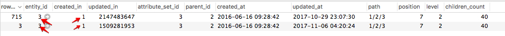
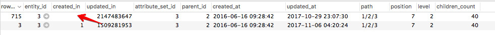

# カテゴリへの変更は保存されません

この記事では、Commerce管理者を使用して製品カテゴリを更新する際に、管理者とストアフロントに変更内容が表示されない問題を修正します。 この問題は、`catalog_category_entity` テーブル内のデータが破損していることが原因です。 問題を解決するには、テーブル内の問題のあるカテゴリ更新レコードを修正または削除します。 その後、管理者を使用して製品カテゴリを更新できるようになります。

## イシュー

管理画面で製品カテゴリを変更して保存すると、新しい更新は管理画面とストアフロントに保存も表示もされません。

### 再生の手順

1. **カタログ** > **カテゴリー**&#x200B;に移動します。
1. カテゴリを選択します。
1. 変更を加え、**保存**&#x200B;をクリックします。
1. メッセージが表示されます：*カテゴリを保存しました*。
1. 変更が保存されていないことに注意してください。

## 原因：`catalog_category_entity` テーブル内のデータが破損しています

この問題は、データベース （DB）内の影響を受けるカテゴリ レコードの`created_in`列の同じ値が原因で発生します。

詳細：

* `catalog_category_entity` DB テーブルには、影響を受けるカテゴリの2つ以上のレコードがあります（これらのレコードの値は同じ`entity_id`です）。
* これらのカテゴリーレコードは、`created_in`列&#x200B;**に**&#x200B;同じ値があります。

### 2番目のDB エントリ（および次のすべてのDB エントリ）は、1つの同じカテゴリのDBでどのように表示されますか？

影響を受けるカテゴリの2番目のDB レコード（および次のDB レコード）は、Magento\_Staging モジュールを使用してスケジュールされたカテゴリの更新があることを意味します。 モジュールは、`catalog_category_entity`内のカテゴリの追加レコードを作成します。これは、想定されるアプリケーション動作です。問題は、レコードが`created_in`列に対して同じ値を持つことです。

### 同じ値はどのように表示されますか？

データ破損の理由を確実に述べることはできません。 考えられる理由は次のとおりです。

* カスタマイズ（コード、テーマなど）
* 不正確なデータ移行
* バックアップからの誤ったデータの復元

このようなデータの破損は、Adobe Commerce インスタンスの「クリーン」（標準装備）では典型的なものではなく、カスタマイズのないAdobe Commerce インストールでは再現できません。

### これが問題であることを確認する方法

`catalog_category_entity` テーブルには、影響を受けるカテゴリの複数のレコードが必要です（レコードの値は`entity_id`である必要があります）。それらのレコードのうち少なくとも2つは、同じ`created_in`値である必要があります。 これにより、ステージングでスケジュールされた更新はCommerce管理者に表示されず、空のスケジュールされた変更ブロックのみが表示されます。

#### 確認する手順

1. データベースのcatalog\_category\_entity テーブルにアクセスします。
1. 影響を受けるカテゴリを特定するentity\_idで、entity\_idでエンティティをフィルタリングします。
1. created\_in列の値が、同じエンティティ\_idを持つ異なるエントリで同じ場合は、このケースになります。 通常、`created_in`値はレコードごとに異なります。

## Solution

次のいずれかのソリューションを選択できます。

1. 問題のあるカテゴリ更新レコードを&#x200B;**削除**
1. **問題のあるカテゴリ更新レコードを**&#x200B;修復します

### 問題のあるカテゴリ更新レコードの削除

このソリューションでは、最初のカテゴリ レコードに正しい`updated_in`値を設定し、このカテゴリの他のすべてのレコードを削除する必要があります。 これにより、予定されているすべてのカテゴリ更新が削除されます。

次の手順に従います。

1. 影響を受けるカテゴリの`entity_id`を含むDB レコードを検索します。
1. `updated_in`列の中で最も大きい整数を持つレコードを選択します。
1. 選択したレコードから`updated_in`値をコピーします。
1. `row_id` = `entity_id` （初期カテゴリレコード）のレコードを選択し、コピーした値をこのレコードの`updated_in`列に貼り付けます。
1. `row_id`が`entity_id`と等しくない行を削除します。

### 問題のあるカテゴリ更新レコードの修復

1. 同じ`entity_id`と同じ`created_in`値を持つカテゴリレコードを検索します。
1. `row_id` = `entity_id`のレコードを選択し、`updated_in`値をコピーします。
1. `row_id`が`entity_id`と等しくないレコードを選択し、コピーした`updated_in`値を`created_in`値として貼り付けます。 以下のスクリーンショットをイラストとして参照してください。    をコピーしています
1. 更新したカテゴリ更新レコード（`created_in`値）が`staging_update` テーブルに存在することを確認します（手順3）。 *例：* コピーされた`created_in`値が1509281953の場合、`row_id` = 1509281953のエンティティは`staging_update` テーブルに存在する必要があります。

## 関連トピックス

[Commerce実装プレイブックのデータベーステーブルを修正するためのベストプラクティス ](https://experienceleague.adobe.com/en/docs/commerce-operations/implementation-playbook/best-practices/development/modifying-core-and-third-party-tables#why-adobe-recommends-avoiding-modifications)
