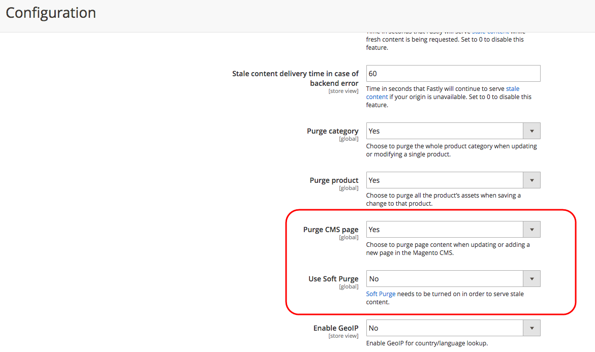

# スケジュールされたコンテンツステージングの更新が、古いFastly キャッシュで表示されない

この記事では、コンテンツステージングとFastlyを使用する際に、Adobe Commerce ストアでスケジュールされた更新が表示されない場合の修正点を紹介します。 この問題は、デフォルトで有効になっているFastly ソフトパージが原因です。 この機能は、アプリケーションリソースの負荷を軽減し、2番目のリクエストに対してのみ新しいキャッシュを再生成します。 この問題を解決するには、Commerce管理者からCMS ページのパージを有効にして、常に新しいコンテンツを再生成して提供できます。

## イシュー

ストアコンテンツアセット（ページ、製品、ブロックなど）のスケジュールされた更新 更新の開始時刻の直後にストアフロントに表示されません。 これは、[&#x200B; コンテンツ ステージング &#x200B;](https://experienceleague.adobe.com/docs/commerce-admin/content-design/staging/content-staging.html)機能を使用して更新がスケジュールされた場合に発生します。

## 原因

Fastlyのソフトパージ機能（デフォルトで有効）により、Adobe Commerce ストアフロントは、更新されたアセットの最初の&#x200B;**リクエストを** Fastlyに送信する際に、古い（古い）キャッシュされたコンテンツを引き続き受け取ります。 Fastlyは、サイトデータの再生成に2回目のリクエストを必要とします。

その結果、Fastlyは、更新されたコンテンツの2回目のリクエストまで、古いコンテンツを配信する場合があります。

**想定されるキャッシュ：** コンテンツステージングを使用してコンテンツアセットの更新をスケジュールした後、Adobe CommerceはFastlyにキャッシュの更新リクエストを送信します。 Fastlyは（コンテンツを削除せずに）以前にキャッシュされたコンテンツを無効化し、更新されたコンテンツの配信を開始します。

**実際のキャッシュ：** Fastlyが、更新されたコンテンツの最初の&#x200B;**要求を**&#x200B;受信したときに古いコンテンツを引き続き配信する場合、再生成された正しいコンテンツは、2番目の&#x200B;**要求を**&#x200B;受信した後にのみ送信されます。 この動作は、web サイト全体のキャッシュを再生成することなく、トラフィックが証明された領域でのみキャッシュを更新することで、サーバーの負荷を軽減するために実装されました。 キャッシュを徐々に更新し、アプリケーションリソースを保存します。

## Solution

最初のリクエストでも古いコンテンツを配信できない場合は、ソフトパージを無効にし、CMSのパージを有効にすることができます。

1. ローカルのCommerce管理者に管理者としてログインします。
1. **Stores** > **Configuration** > **Advanced** > **System** > **フルページキャッシュ**&#x200B;に移動します。
1. **Fastly Configuration**&#x200B;を展開してから、**Advanced**&#x200B;を展開します。
1. **ソフトパージの使用**&#x200B;を&#x200B;*No*&#x200B;に設定します。
1. **CMSのページをパージ**&#x200B;から&#x200B;*はい*&#x200B;に設定します。
1. ページの上部にある「**設定を保存**」をクリックします。

## 関連ドキュメント

* Commerce on Cloud Infrastructure ガイドの[&#x200B; パージ オプションの設定](https://experienceleague.adobe.com/docs/commerce-cloud-service/user-guide/cdn/setup-fastly/fastly-configuration.html)。
* コンテンツとデザイン ドキュメントの[&#x200B; コンテンツ ステージング &#x200B;](https://experienceleague.adobe.com/docs/commerce-admin/content-design/staging/content-staging.html)。
* Fastly ドキュメントの[古いコンテンツの提供](https://docs.fastly.com/guides/performance-tuning/serving-stale-content)。
