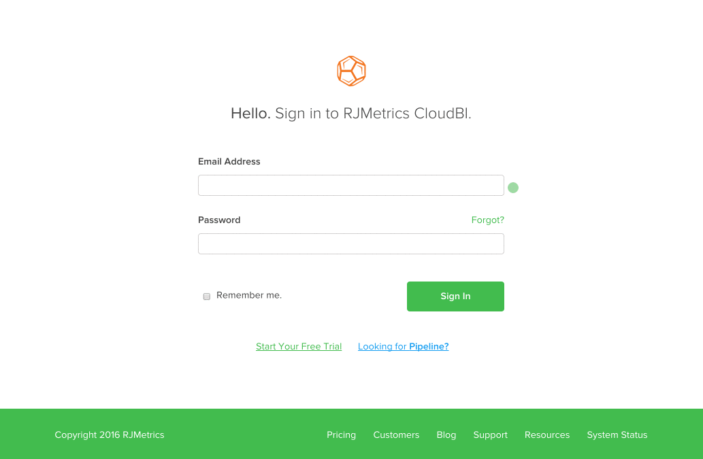

# Adobe Commerce Intelligence アカウントのロックアウトのトラブルシューティング

<!--
BOB: Is this in TOC?
-->

この記事では、Commerce Intelligence アカウントのロックアウトに関する解決策を提供します。 まず、これが欠陥なのか、一時的な不具合なのか、その他のものなのかを判断する必要があります。 以下の手順に従うと、アカウントにできるだけ早く戻るのに役立ちます。

## メールアドレスが正しいことを確認してください

メールアドレスを再確認して、ログインに使用しようとしているメールアドレスが既存のCommerce Intelligence アカウントに関連付けられていることを確認します。 メールアドレスにタイプミスがないことを確認するために、アカウント管理者に問い合わせる必要がある場合があります。

メールアドレスが正しいことを確認したら、[このリンク ](https://dashboard.rjmetrics.com/v2/session/create#/)を使用して再度ログインしてみてください。

## パスワードのリセットをお試しください

正しいメールアドレスを使用していることを確認した場合は、パスワードをリセットしてみてください。 **お忘れですか？**&#x200B;を使用できます 前のセクションのログインページのリンクをクリックして、パスワードリセットメールをトリガーします。

最初にメールが表示されない場合は、必ず迷惑メールフォルダーを探してください。 意図的な電子メールでさえ、迷惑メールと間違われる場合があります。 **これらの電子メールの一時的なアクセス リンクは、一度だけ有効であることに注意してください。**

まだロックアウトされている場合は、メールアドレスが正しいことを確認し、リセットメールの正しいリンクを使用していることを確認してください。 次の&#x200B;**を試してから、もう一度リセットをリクエストし、再度ログインを試みることをお勧めします：**

* ブラウザーのキャッシュ、Cookie、保存されたパスワードの消去
* 広告ブロックソフトウェアを一時的にオフにする

## エラーの文書化とサポートへの問い合わせ

>[!NOTE]
>
>このステップは必ずしも必要なわけではありませんが、事前に完了することで、サポートリクエストとのやり取りにかかる時間を短縮することができます。

それでもアカウントにアクセスできない場合は、エラーを確認し、サポートチームにチケットを送信することをお勧めします。 さまざまな要素が？ ブラウザーの開発者ツールを開き、コンソールまたはサイトログウィンドウに表示されるエラーのスクリーンショットを撮ります。 以下のGIFで、Google Chromeの開発者用ツールを開きます。

上記の例では、最も一般的な方法（**右クリック** > **インスペクト**）を使用してコンソールを開きました。 お使いのブラウザーにこの方法がない場合、またはヘルプが必要な場合は、以下のドキュメントリンクを使用して、お使いのweb ブラウザーを指定します。

<table>
<tbody>
<tr>
<td><a href="https://www.technipages.com/mac-os-x-enable-web-inspector-in-safari">Safari</a></td>
<td><a href="https://developer.mozilla.org/en-US/docs/Tools/Web_Console/Opening_the_Web_Console">Firefox</a></td>
<td><a href="https://developers.google.com/web/tools/chrome-devtools/?hl=en">Chrome</a></td>
<td><a href="https://www.opera.com/dragonfly/documentation/">オペラ</a></td>
<td><a href="https://msdn.microsoft.com/en-us/library/gg589512(v=vs.85).aspx#OpeningTools">Internet Explorer</a></td>
</tr>
</tbody>
</table>

一部のブラウザーでは、開発者ツールを開いてもコンソールが自動的に表示されない場合があります。サイトのコードが最初に表示される場合があります。 この問題が発生した場合は、開発者ウィンドウの「コンソール」オプションをクリックし、そこに表示されるエラーのスクリーンショットを撮ります。

**エラーのスクリーンショット**&#x200B;と&#x200B;**Commerce Intelligence アカウントの電子メールアドレス**&#x200B;を使用して、サポートチームにチケットを送信します。

## エラーが表示されない、または失われただけですか？

心配しないでください！ 新しいサポートチケットを提出してください（必ずCommerce Intelligence アカウントのメールアドレスを含めてください）。できるだけ早くアカウントに戻ります。

## サポートナレッジベースの関連トピック：

* [新しいユーザーの追加と権限の設定](https://experienceleague.adobe.com/docs/commerce-business-intelligence/mbi/administrator/user-mgmt/user-management.html)
* [メールアドレスまたはパスワードを更新するにはどうすればよいですか？](https://experienceleague.adobe.com/docs/commerce-business-intelligence/mbi/administrator/user-mgmt/create-user.html)
* [パスワードをリセットするにはどうすればよいですか？](https://experienceleague.adobe.com/docs/commerce-business-intelligence/mbi/administrator/user-mgmt/reset-password.html)
