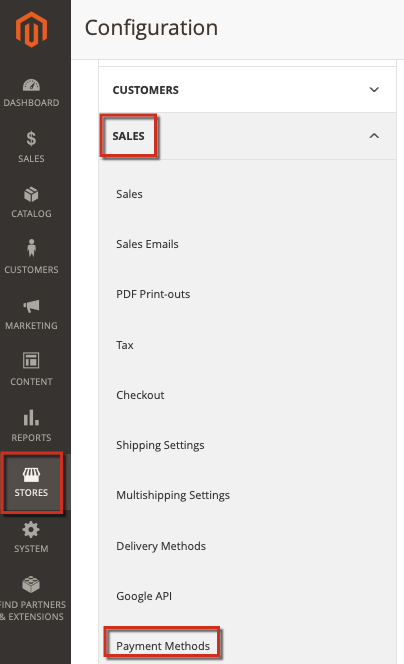

# Adobe CommerceでのPayPalのトラブルシューティング

この記事では、PayPalを介した支払いの処理に関する問題、特にPayFlow Pro ソリューションに関する解決策を提供します。 この記事の一部の推奨事項は明らかのように思えるかもしれません。 このナレッジベースに記載されているトラブルシューティングオプションを試し、入力したチケットにすべての情報を含めてください。 Adobe CommerceまたはPayPal サポートエンジニアは、問題を診断する際に、以下の手順を実行するように求めます。

## 一般的な問題

PayPalの支払いに関するほとんどの問題には、同様の症状があります。支払いカードの詳細を指定してチェックアウトに進むと、支払いが処理されません。 エラーメッセージ、支払い処理の失敗、空のページなどが表示されます。

## 資格情報、暗号化キー、ライセンスを確認する

考えられる問題：アカウントの詳細（ユーザー名、パスワード）、無効なアカウント、期限切れまたは指定されていないライセンス、無効な公開キーと個人キー、およびその他の多くの側面で誤植が発生します。 これらの問題を見つけるには、支払い設定を確認する必要がある場合もあります。

## Adobe CommerceとPayPalで一貫した設定を適用する

同じ設定を適用し、Commerce管理者とPayPal アカウントの両方で同じ機能を有効にしていることを確認してください。

### 設定の問題の例

PayPal Express チェックアウトソリューションを適用する場合、AVS/CSC応答に基づくトランザクションは、**PayPal Manager** （サービス設定/設定/セキュリティオプション）および&#x200B;**Commerce Admin** （**Stores**/Configuration > **Sales** > **支払い方法** ...）で拒否する必要があります。

詳しくは、ユーザーガイドの「[PayPal](https://www.paypalobjects.com/en_US/vhelp/paypalmanager_help/setup.htm)」および「[Adobe Commerce](https://experienceleague.adobe.com/docs/commerce-admin/stores-sales/payments/paypal/paypal-express-checkout.html?lang=ja)」のドキュメントを参照してください。

## 参照トランザクションを許可

PayPalの支払い方法に請求契約書と参照取引を含むAPIが含まれる場合は、設定で正しく有効および設定されていることを確認してください。

### その他のトラブルシューティング

次の記事を参照してください。

* [PayPal ゲートウェイがリクエストを拒否しました – サポートナレッジベースで請求書の問題](https://experienceleague.adobe.com/ja/docs/experience-cloud-kcs/kbarticles/ka-26838)を重複しています。
* [新しいストアエンティティ &#x200B;](/help/how-to/general/change-increment-id-for-a-db-entity-order-invoice-credit-memo-etc-on-particular-store.md)の増分IDをサポートナレッジベースで変更します。

## アドバンスド支払いログを収集するには、サポートにお問い合わせください

複雑な支払いの問題をトラブルシューティングするには、Adobe Commerce サポートチームから、高度な支払いログを有効にするための専用パッチの適用を求められる場合があります。 この場合、手順は次のようになります。

[次の詳細を含むサポートチケット &#x200B;](https://experienceleague.adobe.com/ja/docs/support-resources/adobe-support-tools-guide/adobe-commerce-support/adobe-commerce-help-center-user-guide#submit-ticket)を送信します。

* できるだけ多くの詳細で問題を特定してください。
* この記事、ナレッジベース、その他のリソースから試した手順をリストします。 すべての結果を含める。
* Advanced Payment Logging パッチ（参照番号MDVA-4352）と、そのパッチを適用する手順をリクエストします。

Advanced Payment Logging パッチを受け取った場合：

* パッチを適用します。
* ログを収集し、[&#x200B; サポートチケット &#x200B;](https://experienceleague.adobe.com/ja/docs/support-resources/adobe-support-tools-guide/adobe-commerce-support/adobe-commerce-help-center-user-guide#submit-ticket)に添付します。
* Adobe Commerceサポートチームからの追加の推奨事項をお待ちください。
